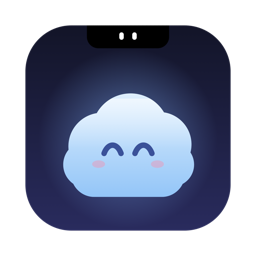

<p align="center"></p>

<h1 align="center">Perch</h1>

<p align="center">A free, open-source AI buddy that lives in your Mac's notch.<br>
It sees your screen, listens when you hold a key, talks back, points at things, and hands real work to helper agents.</p>

<p align="center"></p>

Bring your own [OpenRouter](https://openrouter.ai) key. No account, no paywall, no telemetry.

## Demo

**Guide mode.** Ask "how do I…" or "help me…" and Perch answers out loud, marks the exact button on your screen and points at it with its cursor.


**Answers in the notch.** Type or talk, and the reply drops down from the notch.


**Settings.**

| Voice | Microphone |
|---|---|
|  |  |
| **Shortcuts** | **General** |
|  |  |

The demo images are rendered from the app's real views with sample text: `Perch --demo-shots docs/demo`.

## What it does

- **Talk or type.** Hold Control + Option to talk, or double-tap Control to type in the notch.
- **Guide or do.** "Help me make a poster" gets step-by-step guidance with on-screen marks. "Make a poster" hands the job to a helper agent that does it. Saying "agent" first always hands it over.
- **Helper agents.** Background agents that use your Mac (open apps, click, type), the web, files and connected apps. Create your own, or group them into squads.
- **Speech to text.** NVIDIA Parakeet on-device (free, offline) or ElevenLabs Scribe v2 through your OpenRouter key (most accurate).
- **Natural voice.** Kokoro, running privately on your Mac.
- **Dictation.** Hold Control + Shift in any text box and your words are typed where the cursor is.
- **Fix spelling.** Select text anywhere and press Option + Shift + U.
- **Model switcher.** Pick any OpenRouter model; fast ones are suggested.
- **Multi-monitor aware.** The notch follows your screen layout; non-notch screens get a small mascot pill.

## Install

Requires macOS 14 or later and Xcode 15.3+ (Swift 5.10).

```bash
git clone https://github.com/nadim-sheikh/perch.git
cd perch
./build.sh
```

The app is installed to `~/Applications/Perch.app`. Then:

1. Open Perch. The mascot appears in the notch.
2. In **Settings → AI Models**, paste your OpenRouter key. It's stored in your Keychain.
3. Allow Microphone, Screen Recording and Accessibility when asked, then quit and reopen Perch once.
4. Hold **Control + Option** and talk.

`build.sh` signs with a local certificate named "Perch Developer" when you have one, so macOS keeps Perch's permissions between builds. Without it the app is signed ad hoc and permissions reset on each build.

## Project layout

```
Sources/Perch/            the app
  Agents/                 helper agents, tools, connectors (MCP), squads
  Operator/               Mac control, dictation, fix-spelling, quick commands
Resources/                Info.plist, entitlements, app icon
Tools/make-icon.swift     generates the app icon
docs/demo/                README images (rendered by --demo-shots)
docs/qa/                  QA notes
build.sh                  build, sign and install
```

## Privacy

- Your key, chats and helpers stay on your Mac.
- Screenshots and questions go only to the model you picked on OpenRouter, and only when you ask something.
- Parakeet speech recognition and the Kokoro voice run entirely on-device. Scribe sends your recording to OpenRouter.

## Legal

Perch is an original open-source project. MIT licensed, see [LICENSE](LICENSE).
