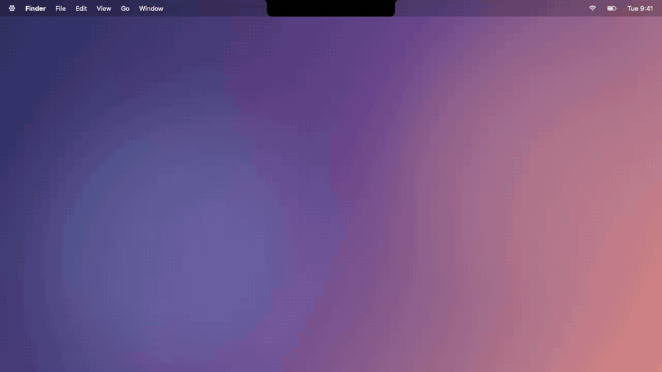

<p align="center"></p>

<h1 align="center">Perch</h1>

<p align="center">A free, open-source AI buddy that lives in your Mac's notch.<br>
It sees your screen, listens when you hold a key, talks back, points at things, and hands real work to helper agents.</p>

<p align="center">
  <a href="https://github.com/nadim-sheikh/perch/releases/latest"><b>⬇️ Download for Mac</b></a> ·
  <a href="docs/demo/perch-demo.mp4">Watch the demo video</a> ·
  Made by <a href="https://x.com/Nadim_404">Nadim Sheikh</a>
</p>

<p align="center"></p>

Bring your own key from **Anthropic, OpenAI or xAI (Grok)**. Optional **ElevenLabs** key for cloud voice. No account, no paywall, no telemetry.

## What it does

- **Talk or type.** Hold <kbd>Control</kbd> + <kbd>Option</kbd> to talk, or double-tap <kbd>Control</kbd> to type in the notch.
- **Guide mode.** Ask "how do I…" or "help me…" and Perch answers out loud, marks the exact button on your screen and points at it with its cursor.
- **Agent mode.** Ask for something ("make a landing page for my bakery") and a helper agent does the work in the background: it uses your Mac (opens apps, clicks, types), the web and files, and shows its progress in the notch.
- **Your own helpers.** Create helpers with their own role, or group them into squads.
- **Dictation.** Hold <kbd>Control</kbd> + <kbd>Shift</kbd> in any text box and your words are typed where the cursor is.
- **Fix spelling.** Select text anywhere and press <kbd>Option</kbd> + <kbd>Shift</kbd> + <kbd>U</kbd>.
- **Voice in and out.**
  - Speech to text: **NVIDIA Parakeet** on your Mac (free, offline) or **ElevenLabs Scribe** with your ElevenLabs key.
  - Voice: **Kokoro** on your Mac (free, private) or **ElevenLabs** voices with your key.
- **Pick your model.** Fast defaults for each provider, or type any model id.
- **Multi-monitor aware.** The notch follows your screen layout; screens without a notch get a small mascot pill.
- **Connections** to Gmail, GitHub, Notion, Slack and more: coming soon.

## Install

**Download:** grab `Perch-x.y.z.dmg` from [Releases](https://github.com/nadim-sheikh/perch/releases/latest), open it and drag Perch to Applications.

Perch isn't notarized by Apple (that needs a paid developer account), so the first time:
right-click Perch in Applications → **Open** → **Open**. Or open it once, then go to
System Settings → Privacy & Security and click **Open Anyway**.

**Build from source** (macOS 14+, Xcode 15.3+):

```bash
git clone https://github.com/nadim-sheikh/perch.git
cd perch
./build.sh        # installs to ~/Applications/Perch.app
./make-dmg.sh     # or: package dist/Perch-<version>.dmg
```

## Set up

1. Open Perch. The mascot appears in the notch.
2. **Settings → AI Models:** choose Anthropic, OpenAI or xAI and paste your key. Keys are stored in your Keychain.
   - [Anthropic key](https://platform.claude.com/settings/keys) · [OpenAI key](https://platform.openai.com/api-keys) · [xAI key](https://console.x.ai)
3. Optional, **Settings → Voice:** pick ElevenLabs and paste your [ElevenLabs key](https://elevenlabs.io/app/settings/api-keys). Otherwise everything voice-related runs on your Mac.
4. Allow Microphone, Screen Recording and Accessibility when asked, then quit and reopen Perch once.
5. Hold **Control + Option** and talk.

## Privacy

- Your keys, chats and helpers stay on your Mac.
- Screenshots and questions go only to the AI provider you picked, and only when you ask something.
- Parakeet and Kokoro run entirely on-device. ElevenLabs is used only if you choose it.

## Project layout

```
Sources/Perch/            the app
  Agents/                 helper agents, their tools, squads
  Operator/               Mac control, dictation, fix spelling, quick commands
  AIProvider.swift        Anthropic / OpenAI / xAI requests, ElevenLabs voice
Resources/                Info.plist, entitlements, app icon
Tools/make-icon.swift     generates the app icon
docs/demo/                the demo GIF and video (Perch --demo-video docs/demo renders the video)
build.sh, make-dmg.sh     build, sign, install and package
```

## Credits

Made by **Nadim Sheikh**: [@Nadim_404 on X](https://x.com/Nadim_404).

Speech recognition and on-device voice use [FluidAudio](https://github.com/FluidInference/FluidAudio) (Apache 2.0) with NVIDIA Parakeet and Kokoro models.

Perch is an original open-source project. MIT licensed, see [LICENSE](LICENSE).
